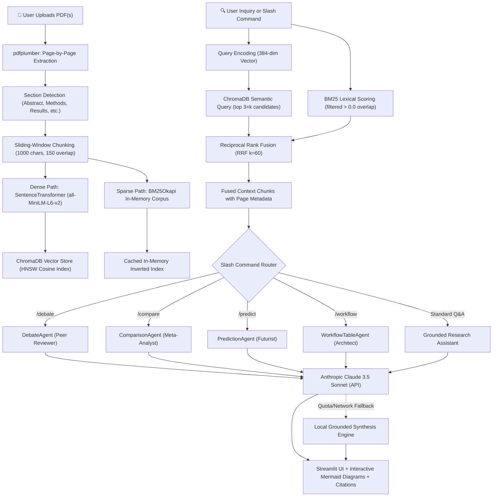

# 🔬 ResearchRadar — Autonomous Research RAG & Multi-Agent Intelligence Engine

> **Ingest academic research PDFs. Retrieve with Hybrid Dense + Sparse RRF search. Spar with specialized AI agents using slash commands. Dynamically inspect author bias and empirical rigor.**


---

## 📖 What is ResearchRadar?

**ResearchRadar** is an agentic, high-precision **Retrieval-Augmented Generation (RAG)** platform designed specifically for academic and technical research. Traditional RAG systems rely solely on semantic vector search, frequently missing acronyms, model variants, numerical benchmark results, and exact terminology. 

ResearchRadar solves this by combining:
1. **Hybrid Retrieval**: Parallel Dense Semantic Search (`all-MiniLM-L6-v2` in ChromaDB) and Sparse Lexical Search (`BM25Okapi`) fused via **Reciprocal Rank Fusion (RRF, $k=60$)**.
2. **Multi-Agent Intelligence Plugins**: Four specialized research agents invoked via slash commands (`/debate`, `/compare`, `/predict`, `/workflow`) that evaluate claims from adversarial, comparative, theoretical, and architectural perspectives.
3. **Interactive Dynamic Visualizations**: Renders embedded **Mermaid.js** architecture flowcharts directly in the chat UI.
4. **Dynamic Semantic & Bias Dashboard**: Algorithmic inspection of author objectivity, claim-to-caution ratios, cross-paper cosine similarity heatmaps, and real-time discourse tension tracking.
5. **100% Offline / Local Fallback**: When no Claude API key is configured or quota is exhausted, the engine automatically falls back to a persona-aware local grounded synthesis mode with verified source-page citations.

---

## ✨ Key Features

| Feature | Description |
|:---|:---|
| 🔍 **Hybrid RRF Search** | Dense vector similarity (ChromaDB cosine HNSW) + sparse keyword ranking (BM25Okapi) merged via Reciprocal Rank Fusion ($k=60$). |
| 🥊 **Adversarial Debate Agent (`/debate`)** | Acts as an elite peer reviewer; presents arguments FOR vs AGAINST, uncovers hidden assumptions, stress-tests claims, and provides an empirical robustness verdict. |
| ⚖️ **Comparative Meta-Analyst (`/compare`)** | Contrasts methodologies, datasets, benchmarks, and efficiency/accuracy trade-offs side-by-side across multiple indexed papers. |
| 🔮 **Theoretical Futurist Agent (`/predict`)** | Analyzes fundamental mechanics, mathematical bottlenecks, scaling ceilings, and projects 3–5 year industry trajectories. |
| 🔄 **Architecture & Workflow Agent (`/workflow`)** | Reconstructs computational data pipelines as interactive **Mermaid.js flowcharts** and extracts ablation tables. |
| 🛡️ **Semantic Bias & Objectivity Inspector** | Evaluates hedging vs overclaiming density, limitation disclosures, and empirical baseline diversity to assign an Objectivity Score (0–100). |
| 🌐 **Cross-Paper Similarity Heatmap** | Computes pairwise cosine similarity between document centroid vectors (derived from 384-dimensional chunk embeddings). |
| ⚡ **Live Discourse Tension Monitor** | Dynamically tracks which academic sections are under scrutiny and measures query tone (Adversarial, Technical, Comparative, Exploratory). |
| 📌 **Strict Citation Integrity** | Every retrieved passage, synthesized response, and local fallback cites exact paper titles, section headings, and page numbers. |
| 🖥️ **Obsidian Glassmorphism UI** | Modern Microsoft Fluent 2 & Google Material You inspired dark canvas, custom typography (`Plus Jakarta Sans` & `JetBrains Mono`), and reactive chips. |

---

## 🏗️ System Architecture & Data Flow



---

## 🔬 Core Components & Implementation Details

### 1. Ingestion & Token-Aligned Chunking (`core/engine.py`)
- **PDF Extraction**: Uses `pdfplumber` to preserve multi-column formatting and layout integrity page by page.
- **Section Detection**: Multi-line regex (`SECTION_PATTERN`) dynamically classifies chunks into academic sections (*Abstract*, *Introduction*, *Methodology*, *Experiments*, *Results*, *Limitations*, etc.).
- **Token Window Alignment**: Chunk size is set strictly to `1000 characters` with `150 character overlap`. 1000 characters corresponds to ~200–240 WordPiece tokens, fitting safely within `all-MiniLM-L6-v2`'s 256-token context window to prevent silent tail truncation.
- **Deterministic Deduplication**: Chunks are keyed via SHA-256 hashes (`paper_name + page + chunk_index + text[:40]`), preventing duplicate entries upon repeated uploads.

### 2. Dense Semantic Search (`all-MiniLM-L6-v2`)
- **Model**: Hugging Face's `sentence-transformers/all-MiniLM-L6-v2`.
- **Dimensions**: 384-dimensional dense vectors.
- **Execution**: Runs **100% locally on CPU/GPU** with zero external API calls. Downloaded and cached on first run.
- **Vector Database**: **ChromaDB** (`PersistentClient`) configured with `{"hnsw:space": "cosine"}`.

### 3. Sparse Lexical Search (`BM25Okapi`)
- Uses `rank_bm25` over the tokenized corpus.
- Employs an in-memory cache keyed by active document filters to guarantee sub-10ms query execution.
- **Positive Overlap Filtering**: Automatically ignores chunks with BM25 scores $\le 0.0$ to prevent irrelevant keyword noise during rank fusion.

### 4. Reciprocal Rank Fusion (RRF)
Fuses the dense semantic candidates and sparse lexical candidates without needing score calibration:

$$\text{RRF Score}(d) = \sum_{m \in \{\text{Dense}, \text{BM25}\}} \frac{1}{k + \text{rank}_m(d)}$$

Where constant $k = 60$. Documents identified by both retrieval pipelines are elevated to the top, balancing conceptual paraphrasing with exact term precision.

### 5. Multi-Agent Intelligence Plugins (`core/plugins.py`)
- **`DebateAgent` (`/debate`)**: Constructs an adversarial academic debate examining core defenses versus hidden assumptions and baseline limitations.
- **`ComparisonAgent` (`/compare`)**: Synthesizes side-by-side architectural matrices, points of divergence, and Pareto trade-offs (efficiency vs accuracy).
- **`PredictionAgent` (`/predict`)**: Dissects theoretical mechanics, identifies systemic hardware/compute bottlenecks, and outlines 3–5 year trajectories.
- **`WorkflowTableAgent` (`/workflow`)**: Generates syntactically clean `mermaid` code blocks that render into interactive visual flowcharts alongside ablation tables.

### 6. Analytics & Bias Engine (`core/analytics.py`)
- **Objectivity & Bias Analysis**: Scans for scientific hedging (`suggests that`, `hypothesize`), overclaiming superlatives (`flawless`, `unbeatable`, `superior in every`), and explicit limitation disclosures.
- **Centroid Similarity Matrix**: Computes paper-level embedding centroids from ChromaDB to construct pairwise cosine similarity heatmaps.
- **Author Stance Breakdown**: Categorizes document sentiment into *Optimistic*, *Cautious*, *Critical*, or *Neutral*.
- **Dynamic Discourse Tension**: Tracks live user inquiries against academic sections to visualize real-time analytical scrutiny.

---

## 📂 Repository File Structure

```
Researchradar/
│
├── app.py                     # Streamlit application, slash command routing & dashboard
├── requirements.txt           # Production dependencies
├── .env.example               # Template environment configuration
│
├── core/
│   ├── __init__.py            # Package initialization
│   ├── engine.py              # PDF extraction, chunking, embeddings, ChromaDB & Hybrid RRF
│   ├── plugins.py             # Debate, Comparison, Prediction & Workflow agent plugins
│   ├── analytics.py           # Bias scoring, similarity matrix, stance & discourse metrics
│   └── ui.py                  # Obsidian glassmorphism design system (CSS)
│
└── data/
    └── chroma_db/             # Persistent ChromaDB vector storage (HNSW index)
```

---

## ⚡ Quick Start

### 1. Prerequisites
- Python 3.10 or higher
- Git

### 2. Clone and Setup Environment

```bash
# Clone the repository
git clone https://github.com/SHANip9/Researchradar.git
cd Researchradar

# Create virtual environment
python -m venv venv

# Activate virtual environment
# Windows (PowerShell):
.\venv\Scripts\Activate.ps1
# macOS / Linux:
source venv/bin/activate

# Install dependencies
pip install -r requirements.txt
```

### 3. Configure Environment Variables

Copy `.env.example` to `.env`:

```bash
cp .env.example .env
```

Edit `.env` to configure your keys:

```env
# Anthropic API Key (Optional — fallback local grounded RAG engine active if omitted)
ANTHROPIC_API_KEY=your_anthropic_api_key_here

# Model Selection (Default: Claude 3.5 Sonnet)
CLAUDE_MODEL=claude-3-5-sonnet-20241022
```

> **Note:** If `ANTHROPIC_API_KEY` is not provided or quota runs out, ResearchRadar will automatically run in **Local Grounded RAG mode** with full citation and quote extraction capabilities.

### 4. Run the Application

```bash
streamlit run app.py
```

The application will launch in your browser at `http://localhost:8501`.

---

## 💡 How to Use ResearchRadar

### 1. Ingest Documents
1. In the left sidebar, upload one or more academic research PDFs.
2. The engine will extract pages, generate section-tagged chunks, compute 384-dimensional embeddings, and store them in ChromaDB.
3. Manage indexed papers or reset the database directly from the sidebar.

### 2. Interactive Research Chat & Slash Commands
Use the main chat input to ask direct questions or trigger specialized agents:

| Command | Action | Example |
|:---|:---|:---|
| `/debate <claim>` | Trigger adversarial peer review sparring | `/debate The architecture scales linearly with minimal compute overhead` |
| `/compare <topic>` | Compare methodologies across indexed papers | `/compare Compare attention mechanisms and memory bottlenecks` |
| `/predict <inquiry>` | Forecast theoretical scaling & 3-5 yr trends | `/predict What are the theoretical hardware limits of this model?` |
| `/workflow <aspect>` | Extract Mermaid flowchart & ablation table | `/workflow Reconstruct the complete training pipeline and ablation metrics` |
| *Direct Question* | Grounded research Q&A with citations | *What datasets were used to evaluate baseline performance?* |

### 3. Dynamic Semantic Dashboard
Switch to the **Dynamic Semantic & Bias Dashboard** tab to view:
- **Paper Objectivity Rating**: Claim-to-caution ratio and limitation transparency.
- **Cross-Paper Heatmap**: Pairwise cosine similarity matrix computed directly from chunk embeddings.
- **Dynamic Section Scrutiny**: Real-time breakdown of which paper sections your questions are targeting.
- **Author Stance Distribution**: Breakdown of optimistic vs cautious assertions.

---

## 🎯 Technologies Used

- **Language & Frameworks**: Python 3.10+, Streamlit
- **Vector Search & Storage**: ChromaDB (`PersistentClient`, HNSW Cosine Index)
- **Local Embeddings**: Hugging Face `sentence-transformers` (`all-MiniLM-L6-v2`)
- **Lexical Search**: `rank-bm25` (BM25Okapi)
- **PDF Extraction**: `pdfplumber`
- **LLM Reasoning**: Anthropic Claude 3.5 Sonnet via `anthropic` SDK
- **Data Analytics & Math**: NumPy, Pandas
- **Visualizations**: Plotly Express, Mermaid.js (via Streamlit HTML components)

---

## 📄 License

This project is licensed under the [MIT License](LICENSE).
