# ResearchRadar — System Architecture

## Overview

ResearchRadar is an **Autonomous Research RAG (Retrieval-Augmented Generation) & Multi-Agent Intelligence System** for academic literature and technical documentation.

Instead of passing monolithic documents directly to an LLM (costly, high-latency, context truncation), ResearchRadar processes PDF documents into semantically partitioned, section-aware chunks stored inside a persistent vector database (ChromaDB) and an inverted lexical index (BM25Okapi).

Retrieval combines dense semantic embeddings and sparse lexical matching fused via **Reciprocal Rank Fusion (RRF)**. Queries are routed dynamically to specialized multi-agent plugins (`/debate`, `/compare`, `/predict`, `/workflow`) or direct grounded Q&A, strictly cited against page numbers and sections.

---

## 🏗️ High-Level System Architecture

```mermaid
graph TD
    subgraph Ingestion Pipeline
        A["📄 Research PDF Upload"] --> B["core/security.py<br/>(Header & Size Validation)"]
        B --> C["core/pdf_processor.py<br/>(PDFPlumber Extraction & Section Detection)"]
        C --> D["core/pdf_processor.py<br/>(Sliding-Window Token Chunking)"]
        D --> E["core/embedder.py<br/>(all-MiniLM-L6-v2 384-dim)"]
        E --> F[("ChromaDB Vector Store<br/>(HNSW Cosine Index)")]
    end

    subgraph Query & Multi-Agent Pipeline
        G["💬 User Query / Slash Command"] --> H["core/security.py<br/>(Sanitization & Validation)"]
        H --> I["core/query_router.py<br/>(Slash Command Router)"]
        I --> J["core/retriever.py<br/>(Dense ChromaDB + Sparse BM25)"]
        J --> K["core/retriever.py<br/>(Reciprocal Rank Fusion k=60)"]
        K --> L["core/plugins.py<br/>(Debate / Compare / Predict / Workflow)"]
        L --> M["core/llm_handler.py<br/>(Claude 3.5 Sonnet / Local Grounded Synthesis)"]
        M --> N["memory/conversation.py<br/>(Sliding-Window Context Memory)"]
        N --> O["🖥️ Streamlit Obsidian-Slate UI<br/>(Chat Console + Dynamic Dashboard)"]
    end
```

---

## 🔄 Dual Pipeline Breakdown

### Pipeline 1: Indexing & Knowledge Base Ingestion

Runs whenever one or more PDF research papers are uploaded:

1. **Security & Header Validation (`core/security.py`)**:
   - Validates file extensions (`.pdf`).
   - Restricts file sizes to configurable thresholds (default: 50MB).
   - Validates `%PDF-` magic header bytes to block spoofed or corrupted payloads.
2. **Page Extraction & Section Detection (`core/pdf_processor.py`)**:
   - Uses `pdfplumber` to extract page-by-page text.
   - Detects standard academic section headers (`Abstract`, `Introduction`, `Methodology`, `Results`, `Limitations`, `Conclusion`, `References`).
3. **Sliding-Window Token Chunking (`core/pdf_processor.py`)**:
   - Splits text into target chunks (1000 characters ≈ 200–240 tokens), fitting strictly within the embedding model's 256-token context window.
   - Applies an overlap of 150 characters with paragraph-aware splitting to preserve semantic cohesion.
   - Emits collision-resistant chunk IDs (`hashlib.sha256`).
4. **Local Vector Embedding (`core/embedder.py`)**:
   - Encodes text chunks into 384-dimensional normalized vectors using `all-MiniLM-L6-v2`.
5. **Persistent Vector Indexing (`core/vector_store.py`)**:
   - Writes chunk embeddings, document text, and metadata to ChromaDB (`data/chroma_db/`) under the `researchradar_v3` collection.

---

### Pipeline 2: Query, Hybrid Retrieval & Multi-Agent Reasoning

Runs on every question or slash command:

1. **Input Sanitization & Routing (`core/query_router.py`)**:
   - Cleans control characters and bounds query length.
   - Detects Codex-style slash commands:
     - `/debate <claim>`: Adversarial debate agent (arguments for vs against, hidden assumptions, robustness scoring).
     - `/compare <topic>`: Comparative meta-analyst (multi-paper matrix, points of divergence, consensus, trade-offs).
     - `/predict <inquiry>`: Technical futurist (theoretical mechanics, scaling bottlenecks, 3–5 year horizons).
     - `/workflow <aspect>`: Architecture systems engineer (Mermaid visual flowchart + ablation table extraction).
     - Plain text queries: Default grounded research Q&A.
2. **Hybrid Retrieval (`core/retriever.py`)**:
   - **Dense Semantic Retrieval**: Computes cosine similarity in ChromaDB.
   - **Sparse Lexical Retrieval**: In-memory cached `BM25Okapi` filters exact terminology matches.
   - **Reciprocal Rank Fusion (RRF)**: Combines rankings using:
     $$\text{RRF Score} = \frac{1}{60 + \text{rank}_{\text{semantic}}} + \frac{1}{60 + \text{rank}_{\text{bm25}}}$$
3. **Synthesis & Grounded Citations (`core/llm_handler.py`)**:
   - Sends strictly grounded system prompts and top-k context passages to **Claude 3.5 Sonnet**.
   - If Anthropic API quota or keys are unavailable, automatically falls back to **Local Grounded Synthesis**, extracting real verified citations with zero runtime failure.
4. **Conversation Memory (`memory/conversation.py`)**:
   - Stores up to 5 Q&A interaction turns in a bounded sliding window for contextual follow-ups.

---

## 📊 Dynamic Semantic & Bias Analytics (`core/analytics.py`)

ResearchRadar includes an analytical dashboard engine operating over the indexed corpus and user inquiry session:

- **Semantic Bias & Objectivity Inspector**:
  - Evaluates author claim-to-caution ratios.
  - Measures scientific hedging density vs superlative overclaiming.
  - Verifies disclosure of limitations and empirical baselines.
- **Cross-Paper Cosine Similarity Heatmap**:
  - Computes pairwise cosine similarity across aggregated document vectors.
- **Stance & Tone Distribution**:
  - Classifies passages into Optimistic, Cautious, Critical, and Neutral stances.
- **Live Inquiry Semantic Scrutiny**:
  - Measures dynamic discourse tension based on user question framing and agent debates.
  - Maps inquiry scrutiny percentages across academic sections.

---

## 🛡️ Enterprise Security & Observability

- **Centralized Configuration (`core/config.py`)**: Single source of truth for paths, model parameters, and rate/size bounds.
- **Defensive Validation (`core/security.py`)**: Magic byte PDF verification, path traversal prevention, HTML output escaping.
- **Structured Logging (`core/logger.py`)**: Standardized timestamps, module context, and latency decorators (`@timed`).
- **Operational Metrics (`core/metrics.py`)**: In-memory telemetry tracking request counts, error rates, operation latency percentiles, and uptime health.

---

## 📦 Technology Stack Summary

| Layer | Technology | Purpose |
|---|---|---|
| **User Interface** | Streamlit + Plotly | Obsidian-slate responsive interface with acrylic cards |
| **PDF Extraction** | PDFPlumber | Page-aware multi-column PDF text parser |
| **Embeddings** | SentenceTransformers (`all-MiniLM-L6-v2`) | Local, fast, 384-dimensional dense vectors |
| **Vector Store** | ChromaDB (HNSW Cosine) | Persistent disk-backed vector database |
| **Keyword Search** | BM25Okapi (`rank-bm25`) | In-memory cached sparse inverted index |
| **Rank Fusion** | Reciprocal Rank Fusion (RRF, $k=60$) | Fuses dense and sparse rankings |
| **LLM Reasoning** | Anthropic Claude 3.5 Sonnet | Instruction-followed research synthesis |
| **Diagrams** | Mermaid.js | Sandboxed client-side visual architecture diagrams |
