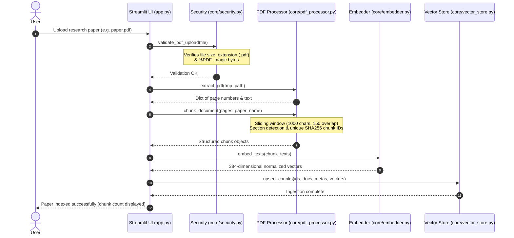
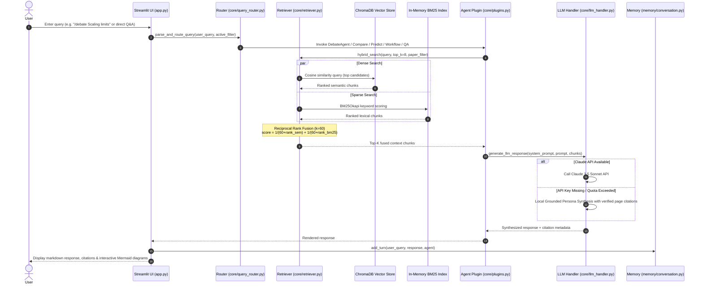

# ResearchRadar — End-to-End Workflow

This document traces the complete execution flow from PDF upload to answer synthesis and dynamic analytical inspection.

---

## Part 1: Document Ingestion Pipeline

---

## Part 2: Query Processing & Hybrid Multi-Agent Retrieval

---

## Part 3: Live Discourse & Semantic Analytics

When the user explores the **Dynamic Semantic & Bias Dashboard**:
1. `core/analytics.py` analyzes the author's claim-to-caution ratio (measuring scientific hedging phrases vs overclaiming superlatives).
2. Computes the **Methodological Rigor Breakdown** (empirical baseline references and limitation disclosures).
3. Evaluates **Dynamic Discourse Tension** by mapping inquiry stances (Adversarial, Technical, Comparative, Exploratory) against the paper's academic sections.
4. Computes cross-paper cosine similarity matrices displayed as interactive Plotly heatmaps.
